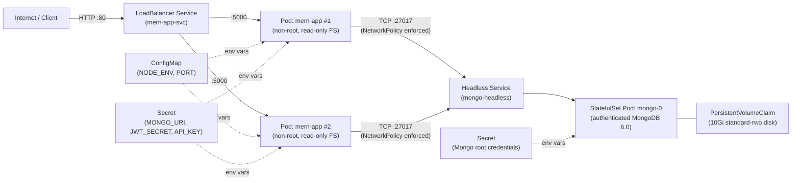

`# MERN Fullstack on Docker Compose & Google Kubernetes Engine (GKE)

A containerized **Node.js + Express + MongoDB** microservice built to demonstrate **secure configuration management** (zero hardcoded or leaked secrets) — runnable locally with **Docker Compose** and deployed to production on **Google Cloud Kubernetes Engine (GKE Autopilot)**.

---

## What This Project Is

At its core, this project is a production-hardened Express API ([`server.js`](mern-env-project/server.js)) backed by MongoDB:

- **Validates required secrets on startup**: Refuses to boot if `MONGO_URI`, `JWT_SECRET`, `PORT`, or `API_KEY` are missing.
- **Zero secret leakage**: Secrets are never baked into Docker images, never committed to Git, never printed in logs, and never exposed in HTTP responses.
- **Health & liveness endpoints**:
  - `GET /` — Returns `MERN server is running!` for API/CLI clients, or a live DevOps status dashboard when opened in a browser.
  - `GET /health` — **Readiness check**; returns `200 OK` (`healthy`) only when MongoDB is connected, or `503 Service Unavailable` (`degraded`) otherwise.
  - `GET /livez` — **Liveness check**; confirms the Node.js HTTP server is alive.
- **Graceful shutdown & resilient DB connection**: Automatically retries MongoDB connections during startup and cleanly closes HTTP and database connections on `SIGTERM` / `SIGINT`.

> Looking for the local Docker Compose deep-dive? See [`mern-env-project/README.md`](mern-env-project/README.md).

---

## How Kubernetes Is Used

In local development, Docker Compose runs 1 app container and 1 database container on a single machine using a `.env` file. For production, **Kubernetes (GKE Autopilot)** takes over orchestration so the app stays **secure, scalable, and always online**.



Here is what each Kubernetes piece in [`mern-env-project/k8s/`](mern-env-project/k8s) does:

| Component | File | Why It's Used (Plain English) |
| :--- | :--- | :--- |
| **Namespace & Pod Security** | [`00-namespace.yaml`](mern-env-project/k8s/00-namespace.yaml) | Isolates all production resources in `mern-prod` and enforces Kubernetes `restricted` security rules (no root containers, no privilege escalation). |
| **ConfigMap** | [`01-configmap.yaml`](mern-env-project/k8s/01-configmap.yaml) | Stores non-sensitive settings (`NODE_ENV=production`, `PORT=5000`) separately from the container image. |
| **Secrets** | [`02-secret.example.yaml`](mern-env-project/k8s/02-secret.example.yaml) | Replaces the local `.env` file with encrypted in-cluster Kubernetes `Secret`s (`mern-app-secret` and `mongo-secret`). Real values are generated at deploy time and never committed to Git. |
| **MongoDB StatefulSet** | [`03-mongo-statefulset.yaml`](mern-env-project/k8s/03-mongo-statefulset.yaml) | Runs authenticated `mongo:6.0` with a stable DNS name (`mongo-0.mongo-headless.mern-prod.svc.cluster.local`) and a `10Gi` persistent disk (`PersistentVolumeClaim`) so database data survives pod restarts. |
| **App Deployment** | [`04-app-deployment.yaml`](mern-env-project/k8s/04-app-deployment.yaml) | Runs **2 replicas** of `mern-app` across zones using zero-downtime rolling updates (`maxUnavailable: 0`), a read-only root filesystem, non-root user (`UID 1000`), and `/livez` + `/health` probes. |
| **LoadBalancer Service** | [`05-app-service.yaml`](mern-env-project/k8s/05-app-service.yaml) | Gives the app a public IP address on port `80` and balances traffic across healthy `mern-app` pods. |
| **Autoscaler (HPA)** | [`06-hpa.yaml`](mern-env-project/k8s/06-hpa.yaml) | Automatically scales `mern-app` between **2 and 6 pods** when CPU usage exceeds `70%`. |
| **NetworkPolicy** | [`07-network-policy.yaml`](mern-env-project/k8s/07-network-policy.yaml) | Acts as an internal firewall: only `mern-app` pods can talk to MongoDB on port `27017`; external traffic is blocked from reaching the database directly. |
| **Disruption Budget (PDB)** | [`08-pdb.yaml`](mern-env-project/k8s/08-pdb.yaml) | Guarantees at least **1 app pod** stays running during cluster maintenance or node upgrades. |

---

## Project Structure

```text
mern-fullstack-main/
├── README.md                              # Project & Kubernetes overview (this file)
└── mern-env-project/
    ├── server.js                          # Express + Mongoose API with /health and /livez
    ├── package.json                       # Node.js dependencies
    ├── Dockerfile                         # Lightweight non-root node:20-alpine image
    ├── docker-compose.yml                 # Local 2-container setup (app + mongo)
    ├── .env.example                       # Template for local environment variables
    ├── README.md                          # Local Docker Compose & secret-hygiene guide
    ├── k8s/                               # Production Kubernetes manifests for GKE
    │   ├── 00-namespace.yaml
    │   ├── 01-configmap.yaml
    │   ├── 02-secret.example.yaml
    │   ├── 03-mongo-statefulset.yaml
    │   ├── 04-app-deployment.yaml
    │   ├── 05-app-service.yaml
    │   ├── 06-hpa.yaml
    │   ├── 07-network-policy.yaml
    │   └── 08-pdb.yaml
    └── scripts/
        └── deploy-gke.sh                  # Automated GCP CLI + kubectl deployment script
```

---

## Quick Start

### Option A: Run Locally with Docker Compose

```bash
cd mern-env-project
cp .env.example .env
docker compose up --build -d

# Verify
curl http://localhost:5000
curl http://localhost:5000/health
```

### Option B: Deploy to Production on GCP (GKE Autopilot)

**Prerequisites**: `gcloud` CLI (authenticated), `kubectl`, `gke-gcloud-auth-plugin`, `docker`, and a GCP project with billing enabled.

1. **Run the automated deployment script** (enables GKE & Artifact Registry APIs, builds & pushes the image, creates the Autopilot cluster, generates strong secrets, and applies all manifests):

   ```bash
   PROJECT_ID="your-gcp-project-id" REGION="asia-south1" ./mern-env-project/scripts/deploy-gke.sh
   ```

2. **Check the cluster & get your public IP**:

   ```bash
   kubectl -n mern-prod get pods,svc,hpa,pdb
   ```

3. **Test the live endpoints**:

   ```bash
   EXTERNAL_IP=$(kubectl -n mern-prod get svc mern-app-svc -o jsonpath='{.status.loadBalancer.ingress[0].ip}')
   curl http://$EXTERNAL_IP/
   curl http://$EXTERNAL_IP/health
   ```

4. **Update the app after code changes**:

   ```bash
   IMAGE_TAG=v1.0.1 PROJECT_ID="your-gcp-project-id" ./mern-env-project/scripts/deploy-gke.sh
   ```

---

## Useful Operations & Cleanup

- **Tail application logs**:
  ```bash
  kubectl -n mern-prod logs -f deployment/mern-app
  ```
- **Delete the GKE cluster when done** (to stop GCP charges):
  ```bash
  gcloud container clusters delete mern-prod-cluster --region=asia-south1 --project=your-gcp-project-id
  ```
