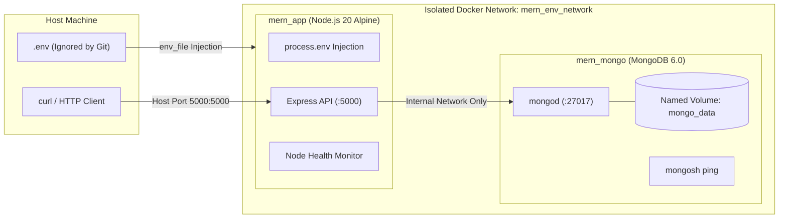

# MERN Environment Variables Using Docker Compose

Production-grade DevOps blueprint for configuring and managing environment variables in a MERN stack application (`Node.js`, `Express`, `Mongoose`) using Docker and Docker Compose with zero secret leakage.

---

## Table of Contents

- [Overview & Purpose](#overview--purpose)
- [Architecture & Security Principles](#architecture--security-principles)
- [Project Structure](#project-structure)
- [Prerequisites](#prerequisites)
- [Environment Configuration](#environment-configuration)
  - [Configuring `.env`](#configuring-env)
  - [Generating Strong Secrets](#generating-strong-secrets)
  - [How `env_file` Works in Docker Compose](#how-env_file-works-in-docker-compose)
- [Quick Start Guide](#quick-start-guide)
  - [1. Start Containers](#1-start-containers)
  - [2. Verify Containers](#2-verify-containers)
  - [3. Inspect Application Logs](#3-inspect-application-logs)
  - [4. Test Endpoints](#4-test-endpoints)
  - [5. Stop Containers](#5-stop-containers)
- [Protecting Secrets from GitHub](#protecting-secrets-from-github)
  - [Git Untracking (`.gitignore` Caveat)](#git-untracking-gitignore-caveat)
  - [Automated Secret Detection & Pre-commit Hooks](#automated-secret-detection--pre-commit-hooks)
- [Security Architecture: `env_file` vs. Docker Secrets](#security-architecture-env_file-vs-docker-secrets)
- [Troubleshooting & FAQ](#troubleshooting--faq)

---

## Overview & Purpose

Managing configuration and secrets securely is a primary DevOps competency. This project establishes best-practice secret management for a containerized Node.js/Mongoose service:

1. **Decoupled Configuration**: Sensitive settings (`JWT_SECRET`, `API_KEY`, `MONGO_URI`, `PORT`) are extracted completely out of source code and Docker images into an ignored `.env` file.
2. **Deterministic Startup**: Docker Compose utilizes health-check dependencies (`condition: service_healthy`) to ensure the Express application only attempts connection once MongoDB is ready to accept traffic.
3. **Defense-in-Depth Secret Redaction**: Secrets are strictly masked in logs and withheld from public HTTP endpoints (`/` and `/health`).
4. **Least Privilege Runtime**: Node container processes execute under the unprivileged `node` user (UID/GID 1000).

---

## Architecture & Security Principles



- **Network Isolation**: MongoDB does NOT map host ports (such as `27017:27017`). It communicates solely through Docker's internal bridge network (`mern_network`).
- **Health-Driven Orchestration**: Express waits until `mongosh --eval "db.adminCommand('ping')"` exits 0 before launching.

---

## Project Structure

```text
mern-env-project/
├── server.js              # Express + Mongoose server with validation & masked logs
├── package.json           # Dependencies and test commands
├── Dockerfile             # Multi-stage/lightweight Alpine image running as non-root
├── docker-compose.yml     # Multi-container orchestration with health dependencies
├── .dockerignore          # Build-context filter preventing .env inclusion
├── .env                   # Local runtime secrets (GIT-IGNORED)
├── .env.example           # Non-sensitive template for developer onboarding
├── .gitignore             # Git exclusions rule set
└── README.md              # Engineering documentation
```

---

## Prerequisites

- [Docker Engine](https://docs.docker.com/engine/install/) (v20.10+ or Docker Desktop)
- [Docker Compose](https://docs.docker.com/compose/) (v2.0+)
- *(Optional for local development)*: [Node.js](https://nodejs.org/) (v18+)

Verify installations:
```bash
docker --version
docker compose version
```

---

## Environment Configuration

### Configuring `.env`

Create a local `.env` file by copying the provided `.env.example`:

```bash
cp .env.example .env
```

Contents of `.env`:

```env
MONGO_URI=mongodb://mongo:27017/mern_db
JWT_SECRET=replace_with_a_strong_secret
PORT=5000
API_KEY=replace_with_your_api_key
```

### Generating Strong Secrets

Never use dictionary words or default placeholders in staging or production. Generate cryptographically strong random strings:

```bash
# Generate a 256-bit base64-encoded secret for JWT_SECRET
openssl rand -base64 32

# Generate a high-entropy hex string for API_KEY
openssl rand -hex 24
```

### How `env_file` Works in Docker Compose

In `docker-compose.yml`:

```yaml
app:
  build: .
  env_file:
    - .env
```

When Docker Compose spins up the `app` container:
1. Docker Compose parses each key-value pair in `.env`.
2. It injects them as standard environment variables directly into the Linux container namespace at container creation.
3. Node.js retrieves them via `process.env.VARIABLE_NAME`.
4. **Crucial Security Benefit**: The secrets are **never baked into the container image layers** during `docker build`, preserving image immutability and portability.

---

## Quick Start Guide

### 1. Start Containers

Build the application image and start services in detached mode:

```bash
docker compose up --build -d
```

### 2. Check Containers

Inspect container status and verify both services transition to `healthy`:

```bash
docker compose ps
```

*Expected output:*
```text
NAME         IMAGE                  COMMAND                  SERVICE   CREATED          STATUS                    PORTS
mern_app     mern-env-project-app   "docker-entrypoint.s…"   app       20 seconds ago   Up 19 seconds (healthy)   0.0.0.0:5000->5000/tcp
mern_mongo   mongo:6.0              "docker-entrypoint.s…"   mongo     20 seconds ago   Up 19 seconds (healthy)   27017/tcp
```

### 3. View Logs

Tail real-time logs from the Node.js application:

```bash
docker compose logs -f app
```

*Expected output (Note that secrets are masked):*
```text
----------------------------------------------------
Initializing MERN Application Server...
Port                : 5000
Environment         : production
JWT_SECRET Configured: Yes (Hidden/Redacted)
API_KEY Configured   : Yes (Hidden/Redacted)
----------------------------------------------------
[SERVER] Listening on http://0.0.0.0:5000
[SECURITY] Secrets verified and securely protected in memory.
[DATABASE] Successfully connected to MongoDB.
```

### 4. Test the Application

Test the primary root endpoint:

```bash
curl http://localhost:5000
```

*Expected response:*
```text
MERN server is running!
```

Test the health monitoring endpoint:

```bash
curl -i http://localhost:5000/health
```

*Expected response (`200 OK` with zero secret exposure):*
```json
{
  "status": "healthy",
  "uptime": 42,
  "database": {
    "status": "connected"
  },
  "service": "mern-env-project",
  "timestamp": "2026-10-28T18:00:00.000Z"
}
```

### 5. Stop the Application

Gracefully shut down containers and networks:

```bash
docker compose down
```

To remove persistent MongoDB volumes as well:
```bash
docker compose down -v
```

---

## Protecting Secrets from GitHub

### Git Untracking (`.gitignore` Caveat)

The `.gitignore` file contains:
```gitignore
.env
.env.*
!.env.example
node_modules/
npm-debug.log*
```

> [!CAUTION]
> **Important Git Rule**: `.gitignore` only ignores **untracked** files! If `.env` was previously added or committed to Git history, adding it to `.gitignore` will NOT remove it from tracking or historical commits.

#### How to Remove `.env` if Already Tracked Without Deleting the Local File:

```bash
# 1. Untrack the file from git staging/index while preserving local file
git rm --cached .env

# 2. Commit the untracking change
git commit -m "security: remove tracked .env file from version control"

# 3. Verify .env is now ignored
git status --ignored
```

#### If secrets were committed in past Git commits:
Use tools like [`git-filter-repo`](https://github.com/newren/git-filter-repo) or [BFG Repo-Cleaner](https://rtyley.github.io/bfg-repo-cleaner/) to purge the commits from git history, and immediately **rotate and revoke** all exposed secrets.

### Automated Secret Detection & Pre-commit Hooks

To prevent accidental secret leaks:
1. **Pre-commit Hooks**: Install `pre-commit` and enable [detect-secrets](https://github.com/Yelp/detect-secrets) or [Gitleaks](https://github.com/gitleaks/gitleaks):
   ```bash
   gitleaks detect --source . -v
   ```
2. **CI/CD Scanning**: Integrate GitHub Actions workflows with secret scanning actions to fail builds whenever credentials patterns are identified.

---

## Security Architecture: `env_file` vs. Docker Secrets

| Dimension | Docker Compose `env_file` | Docker Swarm / Kubernetes Secrets |
| :--- | :--- | :--- |
| **Primary Use Case** | Local development, single-node staging | Production, Swarm, Kubernetes clusters |
| **Storage Mechanism** | Plaintext file on host filesystem | Encrypted Raft log (in-transit & at-rest) |
| **Container Exposure** | Visible via container environment (`docker inspect`, `/proc/1/environ`) | Mounted in-memory as files (`/run/secrets/*`) or secured tempfs |
| **Process Inspection Risk** | Any subprocess or compromised crash dump can inspect `process.env` | Decoupled; file access governed by Linux filesystem permissions |
| **Rotation Support** | Requires container rebuild / recreation | Dynamic re-mounting and rotation without host-level file changes |
| **Audit Logging** | Unaudited file reads | Centralized cluster-level access audit trail |

### Production Recommendation
For multi-node production workloads (AWS ECS, Kubernetes, Docker Swarm), use native secrets managers (e.g. AWS Secrets Manager, HashiCorp Vault, Kubernetes Secrets) mounted as in-memory volumes instead of host `.env` files.

---

## Security Checklist for Production

- [x] `.env` is listed in `.gitignore` and `.dockerignore`.
- [x] Only `.env.example` with benign placeholders is committed.
- [x] Secret variables are masked in all stdout/stderr application logs.
- [x] Secrets are omitted from `/health` and API responses.
- [x] Dockerfile executes under non-root user `node`.
- [x] MongoDB port `27017` is restricted to Docker internal network and unexposed to public interfaces.
- [x] Docker Compose relies on MongoDB health check before launching the application.
